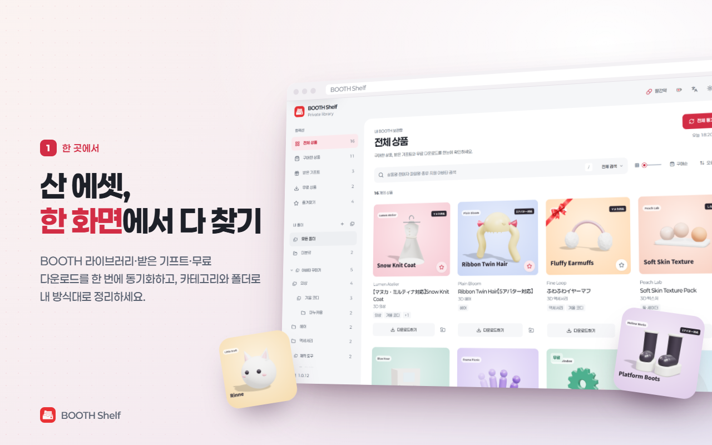
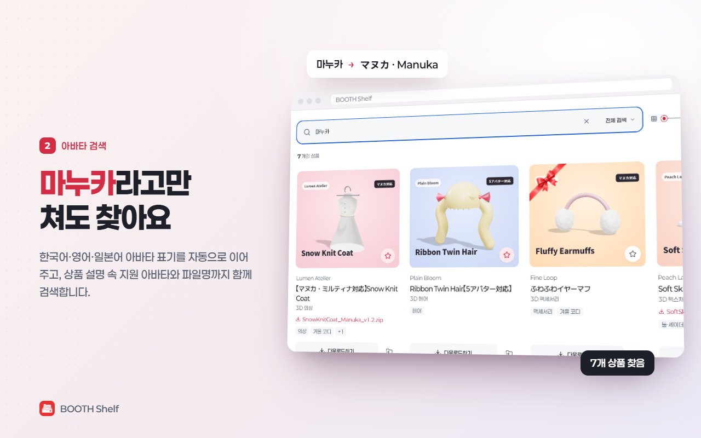
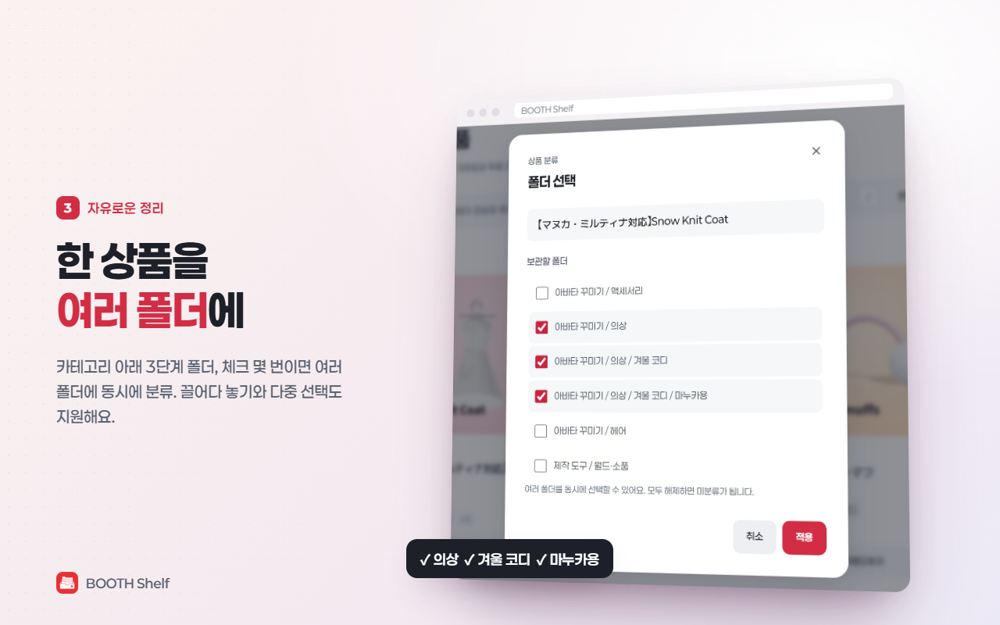
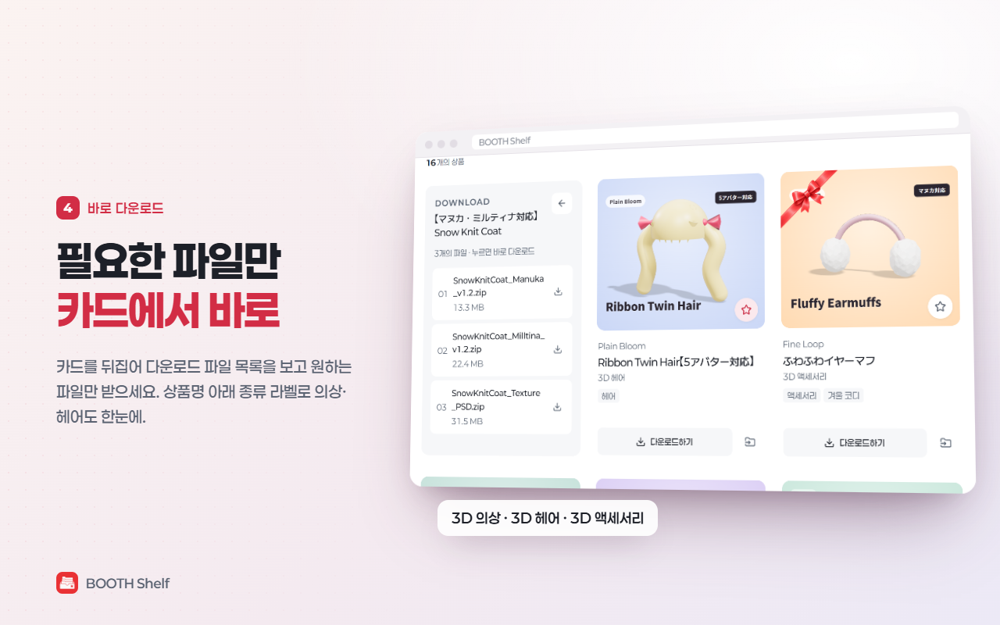
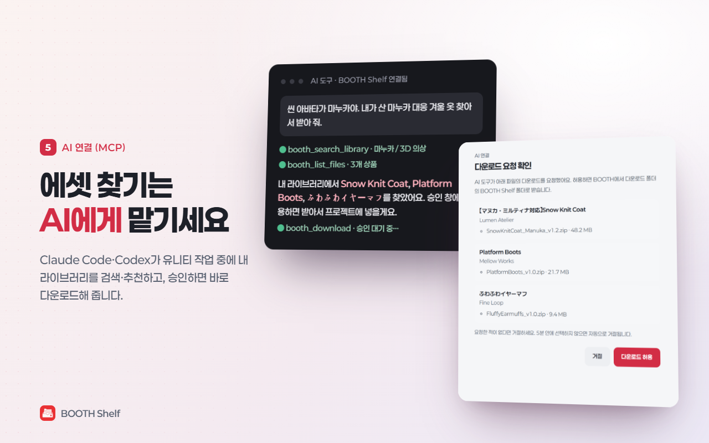

<div align="center">


# BOOTH Shelf

[한국어](README.md) · [English](README.en.md) · **简体中文**

**找回你在 BOOTH 买过的素材，最快的方法**

在一个页面里搜索 BOOTH 的“我的书库”、收到的礼物和免费下载，<br>
并用收藏、分类和最多三层的文件夹整理它们的 Chromium 扩展程序。

[](https://chromewebstore.google.com/detail/aibjhdieagkjmcodaiopaklonjbdmbpj?utm_source=item-share-cb)
[](https://chromewebstore.google.com/detail/aibjhdieagkjmcodaiopaklonjbdmbpj?utm_source=item-share-cb)
[](https://github.com/KuroiineUshina/BOOTH-Shelf/releases/latest)
[](LICENSE)

### [▶ 从 Chrome 应用商店安装](https://chromewebstore.google.com/detail/aibjhdieagkjmcodaiopaklonjbdmbpj?utm_source=item-share-cb)

免费 · 开源 · 所有数据只保存在你的设备上

</div>

https://github.com/user-attachments/assets/f3fc61f1-6b18-4291-9339-c1505544dcab

## 预览

| 整个书库集中在一个页面 | 按虚拟形象名称搜索 |
|:---:|:---:|
|  |  |
| **一个商品放进多个文件夹** | **只下载需要的文件** |
|  |  |
| **AI 连接 (MCP)** | |
|  | |

<sub>截图中的店铺和商品均为演示用的虚构数据。</sub>

> 应用界面目前支持韩语、英语和日语，暂无中文界面。本文中的按钮名称会在括号里附上英文界面的原文，方便对照。

## 主要功能

### 🔄 同步
- 一次同步“书库”“礼物”“免费下载”三个标签页的所有页面
- 同一商品页面下拥有的多个虚拟形象版本，以及购买、礼物、免费条目会合并成一张卡片

### 🔍 搜索
- 按商品名、卖家名、下载文件名，以及商品说明里写到的适配虚拟形象搜索
- 多语言搜索：只输入一个字，也能部分匹配韩语、英语、日语的虚拟形象写法（例如 `마누카` → `マヌカ` · `Manuka`）
- 分析商品说明中的“适配模型”区域和链接到的原始虚拟形象商品，即使标题或文件名里没写，也能搜到适配的虚拟形象
- 如果已有文件名能确认是某个虚拟形象专用版本，就只匹配那个版本；只有没有专用标记的通用文件，才用商品说明里的适配列表作为辅助依据
- 在商品名下方显示 BOOTH 商品类型（3D 服装、3D 发型等），点击类型名或在搜索框选择“类型（Type）”范围即可只看同类商品
- 购买商品、收到的礼物、免费商品筛选，以及收藏
- 像滚筒一样上下转动的“购买顺序 / 名称”排序开关，以及升序 / 降序方向开关

### 🗂️ 整理
- 在可折叠的分类下建立最多三层文件夹，支持重命名、移动、删除
- 一个商品可以同时放进多个文件夹，在卡片上用复选框管理
- 把商品卡片拖到侧边栏的文件夹，即可在保留原有分类的同时加入该文件夹
- 点击卡片多选，并一起拖动多个商品
- 每个文件夹可以写说明，备份和恢复时一并保留
- 卡片和文件夹各有右键菜单，可直接下载、打开商品页、打开卖家店铺或管理文件夹
- 把分类、文件夹、商品归类和收藏备份为 JSON，并可恢复

### 🛒 购物车
- 在侧边栏打开**购物车（Cart）**，按店铺查看 BOOTH 购物车里的商品，并可按商品名、卖家、选项搜索
- 标记或隐藏已经拥有的商品，查看每个店铺的小计和总金额
- 上次同步的购物车保存在本机，打开即可查看；点**同步购物车（Sync cart）**只更新购物车

### ♡ 愿望单
- 在侧边栏打开**愿望单（Wishlist）**，查看在 BOOTH 上点过“喜欢”（スキ）的商品。默认隐藏已拥有和已在购物车里的商品，可用**包含购物车（Include cart）**、**包含已购（Include purchases）**按钮重新显示
- 可按商品名、卖家搜索，售罄和停售的商品会有标记
- 愿望单上次同步的结果同样保存在本机；愿望单页面的**全部同步（Sync all）**会一起更新已购商品、购物车和愿望单

### ⬇️ 下载与跳转
- 翻转卡片查看下载文件列表，直接下载选中的文件
- 点击商品名打开 BOOTH 商品详情页，点击卖家名打开卖家店铺

### 🤖 AI 连接 (MCP)
- 让 Claude Code、Codex 等 AI 工具搜索、推荐你书库里的商品，并下载你允许的文件（[详细说明](#-ai-连接-mcp-1)）

### 🎨 界面与便利功能
- 点击页头的语言图标，在 한국어 → English → 日本語 之间循环切换界面语言
- 浅色、深色、跟随系统主题（跟随系统时会自动反映操作系统的设置变化）
- 每行 4、5、6 张卡片，侧边栏宽度可拖动调整
- 接近列表底部时自动加载更多商品的无限滚动
- 页头的**红药丸（Reality check）**按钮可统计已确认付款订单的实际支付总额
- 可在应用内彻底删除已保存的商品、收藏、分类和文件夹数据
- 响应式布局，支持 `prefers-reduced-motion` 无障碍设置

<details>
<summary>查看更多细节</summary>

- 选中的卡片会轻轻浮起作为高亮，不会抖动。
- 点击卡片的图片或空白处可选中或取消选中多个商品，从任意卡片开始拖动，都只会把选中的那一组移到文件夹。
- 拖动的卡片组碰到侧边栏时，会平滑缩小到 75% 大小、75% 不透明度，数量徽标也会跟着移动。
- 没有放到文件夹上的拖动不会被当作点击选择。
- 为键盘和触屏用户，每个商品都提供**放入文件夹（Add to folder）/ 管理文件夹（Manage folders）**按钮。
- 下载选项很多时，卡片内的文件列表可以单独滚动。
- 主题按钮无动画即时切换，设置保存在本设备上。
- 可以从页头打开开发者的 Ko-fi 赞助页面，以及备份、恢复、删除数据的设置。

</details>

## 安装

### Chrome 应用商店（推荐）

1. 打开 [BOOTH Shelf 的 Chrome 应用商店页面](https://chromewebstore.google.com/detail/aibjhdieagkjmcodaiopaklonjbdmbpj?utm_source=item-share-cb)，点击**添加至 Chrome**。
2. 在同一个浏览器配置文件中登录 [BOOTH 书库](https://accounts.booth.pm/library)。
3. 点击工具栏中的 **BOOTH Shelf**，运行**同步已购（Sync purchases）**。

商店版在新版本审核发布后，浏览器会自动更新。如果看不到扩展图标，请在浏览器的扩展程序菜单里把 BOOTH Shelf 固定到工具栏。

<details>
<summary>从 GitHub Release 直接安装</summary>

1. 从[最新的 GitHub Release](https://github.com/KuroiineUshina/BOOTH-Shelf/releases/latest) 下载 `booth-shelf-vX.Y.Z.zip`。请选择文件名以 `booth-shelf-` 开头的安装包，而不是 GitHub 自动提供的 **Source code** 压缩包。
2. 把 ZIP 解压到一个会长期保留的本地文件夹。
3. 在 Chrome 或基于 Chromium 的浏览器中打开 `chrome://extensions`。
4. 打开右上角的**开发者模式**。
5. 点击**加载已解压的扩展程序**。
6. 选择解压出来的 `booth-shelf` 文件夹。
7. 在同一个浏览器配置文件中登录 [BOOTH 书库](https://accounts.booth.pm/library)。
8. 点击工具栏中的 **BOOTH Shelf**，运行**同步已购（Sync purchases）**。

已解压的扩展程序会直接运行所选文件夹里的 JavaScript。删除或移动该文件夹后扩展将无法加载，请放在固定位置。如果放在 OneDrive 等同步文件夹中，请不要与他人共享该文件夹，并为账号开启多重身份验证。

**更新**：从 GitHub 安装的已解压扩展不会自动更新。请下载新 Release 的安装 ZIP，替换原安装文件夹中的文件，然后在 `chrome://extensions` 中点击 BOOTH Shelf 的**重新加载**按钮。已保存的商品和文件夹存放在浏览器的扩展存储中，只要扩展 ID 不变就会保留；不过仍建议在更新前确认重要的整理数据。

</details>

## 🤖 AI 连接 (MCP)

Claude Code、Codex 等 AI 工具可以在你做 Unity 项目时搜索、推荐你买过的素材，并下载你允许的文件。

> 💬 “帮我找一件适合场景里这个虚拟形象的、我已经买过的衣服，并下载下来”

1. 安装 Node.js 18 或更高版本。
2. 在终端中安装一次连接程序，不需要管理员权限。
   ```bash
   npx booth-shelf-mcp install
   ```
   如果使用的是从 GitHub 下载的已解压版本，请按 BOOTH Shelf 设置里显示的命令加上 `--extension-id <扩展 ID>`。
3. 重启 Chrome，在 BOOTH Shelf 中依次点击**设置（Settings）→ AI 连接 (AI connection (MCP)) → 开启 AI 连接（Turn on AI connection）**，并允许所需权限。
4. 安装时会自动把 MCP 服务器注册到本机的 **Codex**（CLI 和桌面应用）和 **Claude Code**。打开新会话即可使用 BOOTH 工具。如果不想自动注册，请加上 `--no-register`。

AI 可以使用的工具包括：书库搜索、商品文件列表、下载、下载状态查询。

- **默认情况下，每次下载请求都会在浏览器中弹出确认窗口，只有你允许的文件**才会保存到 `下载/BOOTH Shelf/卖家/商品/`。
- 如果在设置中关闭**每次下载前弹出确认窗口（Ask me before every download）**，将不经询问直接下载；即便如此，也只会下载你书库里的 BOOTH 文件，且每次最多 30 个。
- 传给 AI 的只有商品名、卖家、类型、适配虚拟形象和文件名，不会传递下载地址和商品说明原文。
- 连接程序每次运行都会生成新的密钥 token，只接受持有该 token 的本地程序连接。

详情请参阅 [mcp/README.md](mcp/README.md)。

## 🔒 隐私与权限

没有独立的服务器或统计分析工具，所有数据只保存在本浏览器的 `chrome.storage.local` 中。

| 权限 | 何时申请 | 用途 |
|---|---|---|
| `storage` | 始终 | 在本设备上保存用于搜索的商品信息，以及收藏、分类、文件夹结构 |
| `unlimitedStorage` | 始终 | 解除本地存储默认 10MB 的上限，以便保存商品很多的书库。不会额外读取或发送任何数据 |
| `https://accounts.booth.pm/*` | 首次运行**同步已购**、**红药丸**或打开**愿望单**时 | 读取已登录用户的书库、礼物、免费下载页面；运行**红药丸**时读取购买记录中的支付金额；打开**愿望单**时读取点过“喜欢”的商品列表 |
| `https://booth.pm/*` | 首次运行**同步已购**或打开**购物车**时 | 读取已拥有商品的公开商品说明和其中链接的商品，用于识别适配的虚拟形象（不发送登录信息）；读取购物车内容（使用 BOOTH 登录状态，不保存结账地址） |
| `nativeMessaging` · `downloads` · `offscreen` | 仅在开启 **AI 连接**时 | 与本机的连接程序通信、下载已批准的 BOOTH 文件、解析带有下载文件列表的书库页面。关闭 AI 连接时一并撤销 |

<details>
<summary>查看保存的信息与安全细节</summary>

保存的信息包括：商品 ID、商品名、卖家名、缩略图 URL、商品 URL、在书库 / 礼物 / 免费下载页面中的位置、下载文件名和显示的大小、从商品说明中识别出的适配虚拟形象 ID 及确认时间、收藏、分类与文件夹结构及其说明，以及主题、语言、每行卡片数、侧边栏宽度设置。不保存商品说明原文。下载文件名和适配虚拟形象 ID 只用于本地搜索。

**红药丸**的结果只在本设备缓存各币种总额、已确认付款的订单数、免费订单数和计算时间，不保存订单号和单个订单的内容。也不会读取或保存 cookie。

实际的下载 URL 会在你打开**下载（Download）**时从 BOOTH 页面重新读取，只短暂保留在当前页面的内存中，不会写入 `chrome.storage.local`。选中的 URL 会以与 BOOTH 自带按钮相同的页内下载方式只发送给 BOOTH，不使用任何下载记录访问权限。

仅清除浏览器历史记录不会删除扩展存储，请使用页头的**设置 → 删除所有已保存数据（Delete all saved data）**。该按钮在删除数据的同时，也会撤销 BOOTH 账号页和商品页的读取权限。

每次加载时都会校验已保存数据和链接的结构，账号页、商品、卖家和缩略图只使用允许的 BOOTH 地址。明确的内容安全策略（CSP）会阻止远程代码、任意网络连接、框架和对象嵌入。

</details>

详情请参阅[隐私说明](PRIVACY.md)（韩语）。发现安全漏洞时，请不要在公开 Issue 中发布细节，请按照[安全策略](SECURITY.md)中的流程报告。

## ⚙️ 数据行为

<details>
<summary>查看排序、文件夹、同步和红药丸的工作方式</summary>

- **购买顺序升序**直接使用 BOOTH 书库中显示的页面和卡片顺序，降序则反过来显示。
- 排序依据按钮在“购买顺序”和“名称”之间切换，排序方向按钮在升序和降序之间切换。排序始终使用两个按钮上显示的那一种组合。
- 分类不计入文件夹三层的限制。删除分类时，其中的顶层文件夹不会被删除，而是移到**无分类（Uncategorized）**。
- 重新同步时，商品列表会替换为最新状态，仍存在的商品的收藏以及所有分类、文件夹归类都会保留。
- 把卡片拖到文件夹只会新增该文件夹，不会改变原有归类。拖到**未归档（Unfiled）**则会解除该商品的所有文件夹归类。
- 删除文件夹时，只有其子文件夹和放在该文件夹中的归类会上移一级，同一商品在其他文件夹中的归类保持不变。删除顶层文件夹时，只会解除该文件夹的归类。
- 1.0.5 及更早版本的单文件夹归类数据和备份文件，会在首次加载时自动转换为多文件夹格式。
- 如果 BOOTH 的页面结构变化或返回维护页面，同步会中止。只有在确认完购买、礼物、免费下载全部列表之后才保存商品列表；确认失败时会保留原有列表和整理数据。
- **同步已购**会读取购买、礼物、免费下载列表，下载文件名和显示的大小，以及公开商品说明中的适配模型区域和原始虚拟形象商品链接，保存到本地搜索索引。不保存商品说明原文和链接列表，只保存识别出的适配虚拟形象 ID。商品列表保存完成后即可使用，适配虚拟形象的识别会在后台继续进行。商品说明读取的是 BOOTH 轻量的公开商品 JSON（`/items/<ID>.json`），而不是 HTML 页面。每个商品的说明索引会复用 30～45 天并分批保存，因此下次同步不会重复请求已确认的商品，重新确认也不会集中在同一时间。
- 读取说明失败的商品会保留原有适配信息，并在下次同步时重新确认。如果新版本更改了说明的分析方式，旧索引也会被重新确认。
- 打开卡片上的**下载（Download）**时，会从最新的书库页面重新读取实际下载 URL。URL 不会被保存，关闭页面即消失。如果商品位置变化导致找不到列表，请运行**同步已购**后重试。
- 红药丸会对购买记录中已确认付款的订单（`paid`、`completed`、已送达状态）去重，然后汇总订单详情中的“支付金额”。未付款、已取消、已退款的订单会被排除；可能包含 BOOST 和运费；收到的礼物不计入。为减轻服务器负担，结果缓存在本地，只有点击**重新计算（Calculate again）**时才会更新。
- 多个窗口中对收藏、文件夹、设置的修改，会以最新保存值为基准依次应用。保存失败时不会显示为成功。
- 如果多个窗口中的同步、红药丸计算、备份恢复、数据删除同时进行，后开始的操作会中止并提示重试。红药丸计算在摘要保存完成前不会与其他操作重叠。
- 整理数据的备份上限为 32MiB，导出和导入使用相同的大小限制。超过限制时会提示错误，而不会生成无法恢复的文件。
- 请求之间的启动间隔至少为 300ms。同步最多 4 个并行，下载选项和支付统计查询最多各 2 个并行；遇到 BOOTH 的临时错误和限流响应时会等待后重试。
- 商品说明会连续处理，不会因为分批保存而暂停请求。保存一次只进行一个，最终保存完成后才显示完成。在同一次同步中，如果已拥有的商品和虚拟形象链接指向同一个商品，会共享查询和分析结果。

</details>

根据 BOOTH 官方说明，收到的礼物可以在书库的[礼物标签页](https://accounts.booth.pm/library/gifts)中查看。另外，请根据 [BOOTH 指南](https://booth.pm/guidelines)，在不给服务器造成过大负担的范围内使用。本项目是非官方的本地工具，并非 pixiv 或 BOOTH 的官方产品。

## ☕ 赞助

如果想支持开发者，可以点击应用页头的 Ko-fi 杯子图标，或访问 [Ko-fi 赞助页面](https://ko-fi.com/kuroiineushina)。链接会在新标签页中打开，支付和个人信息处理由 Ko-fi 负责。无论是否赞助，所有功能都完全相同。

## 🛠️ 开发

当前开发版本为 **1.0.12**。Manifest 的技术版本号与面向用户显示的版本号保持一致。

无需安装额外依赖，即可使用 Node.js 内置的测试运行器。

```powershell
npm test
npm run check
npm run verify:version
```

如需在没有真实账号数据的情况下预览界面，可以用静态服务器打开 `dashboard.html?demo=1`。演示模式中的整理、设置、计算和删除只作用于该页面的内存，与扩展的真实存储相互隔离。

## 📄 许可证

Copyright (C) 2026 KuroiineUshina

以 [GNU General Public License v3.0](LICENSE) 或更高版本（GPL-3.0-or-later）发布。你可以自由使用、修改和再分发代码，但分发修改后或包含本代码的程序时，也必须按相同的 GPL 条款公开源代码。1.0.12 及之前发布的版本以 MIT License 发布，这些版本继续适用 MIT 条款。

BOOTH 和 pixiv 的名称与服务归各自权利人所有，本项目并非 BOOTH 或 pixiv 的官方产品。

- 界面图标：[Lucide Icons](https://lucide.dev/)（ISC 许可证，全文见 [`assets/lucide/LICENSE`](assets/lucide/LICENSE)）
- 字体：韩语和英语界面使用 [Paperlogy](https://freesentation.blog/paperlogyfont)，日语界面使用 [M PLUS 1](https://mplusfonts.github.io/)。Paperlogy 的拉丁字母基于 Montserrat。两款字体都内置在扩展中，不会下载远程字体。两者均按 SIL Open Font License 1.1 发布，许可证全文和来源见 [`assets/paperlogy`](assets/paperlogy) 和 [`assets/m-plus-1`](assets/m-plus-1)。
- 赞助菜单：使用 [Ko-fi 官方品牌素材](https://more.ko-fi.com/brand-assets)中的杯子图标。Ko-fi 的名称和标志归 Ko-fi 所有。
